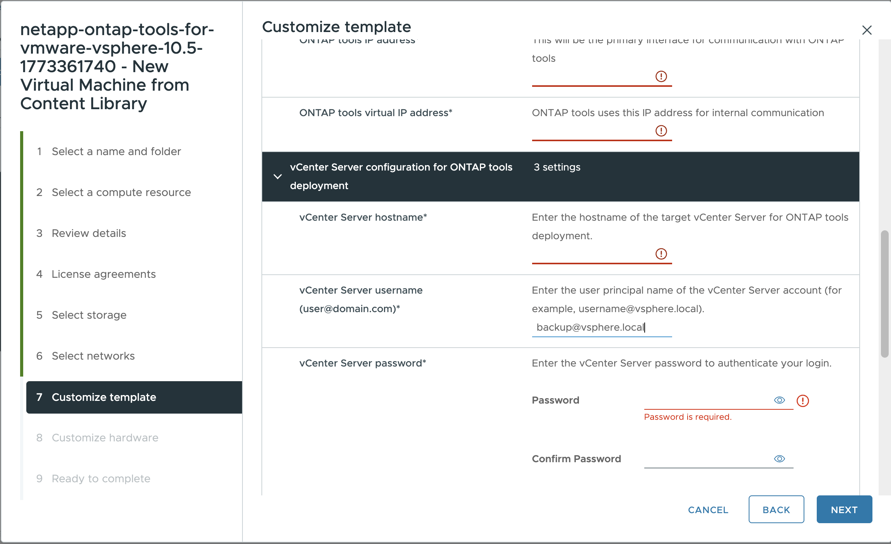

= ONTAP tools를 단일 노드 어플라이언스로 배포합니다.
:allow-uri-read: 
:icons: font
:imagesdir: ../media/

[role="lead"]
NFS 및 VMFS 데이터스토어를 지원하는 초소형 단일 노드 어플라이언스로 ONTAP tools for VMware vSphere를 배포합니다. 배포 프로세스는 최대 45분이 소요됩니다.

.시작하기 전에
초소형 단일 노드 구성을 배포하는 경우 콘텐츠 라이브러리는 선택 사항입니다. 다중 노드 또는 고가용성(HA) 배포의 경우 콘텐츠 라이브러리는 필수입니다.

VMware에서 콘텐츠 라이브러리는 VM 템플릿, vApp 템플릿 및 기타 파일을 저장합니다. 콘텐츠 라이브러리를 사용하면 템플릿 작업 중에 직접적인 네트워크 액세스가 필요하지 않으므로 배포가 간소화됩니다.

콘텐츠 라이브러리를 생성하기 전에:

* 클러스터의 모든 호스트가 액세스할 수 있도록 공유 데이터 저장소에 콘텐츠 라이브러리를 만듭니다.
* ONTAP tools for VMware vSphere OVA를 배포하기 전에 콘텐츠 라이브러리를 생성하십시오.
* 배포 후 OVA 템플릿을 콘텐츠 라이브러리에 보관하십시오.

NOTE: 나중에 HA를 활성화할 계획이라면 ONTAP tools VM을 ESXi 호스트에 직접 배포하지 말고 ESXi 클러스터 또는 리소스 풀에 배포하십시오.

콘텐츠 라이브러리를 생성하려면:

. ONTAP tools for VMware vSphere 바이너리(_.ova_)와 서명된 인증서를 https://mysupport.netapp.com/site/products/all/details/otv10/downloads-tab["NetApp Support 사이트"^]에서 다운로드하십시오.
. vSphere 클라이언트에 로그인합니다.
. vSphere Client 메뉴에서 *콘텐츠 라이브러리*를 선택합니다.
. *생성*을 선택합니다.
. 이름을 입력하고 콘텐츠 라이브러리를 생성합니다.
. 생성한 콘텐츠 라이브러리를 엽니다.
. *작업* > *항목 가져오기*를 선택하고 OVA 파일을 가져옵니다.

NOTE: 자세한 내용은 https://blogs.vmware.com/vsphere/2020/01/creating-and-using-content-library.html["콘텐츠 라이브러리 만들기 및 사용"]을 참조하십시오.

NOTE: 배포 전에 클러스터 분산 리소스 스케줄러(DRS)를 보수적(Conservative)으로 설정하여 설치 중 VM 마이그레이션을 방지하십시오.

ONTAP tools for VMware vSphere는 초기에는 비 HA 구성으로 배포됩니다. ONTAP tools 10.6부터 CPU 핫 추가 및 메모리 핫 플러그가 기본적으로 활성화됩니다. 나중에 HA로 확장하려면 이러한 기능을 활성화해야 합니다.

.단계
. ONTAP tools OVA 파일과 서명된 인증서를 https://mysupport.netapp.com/site/products/all/details/otv10/downloads-tab["NetApp Support 사이트"^]에서 다운로드하십시오. 이미 OVA를 콘텐츠 라이브러리로 가져온 경우 이 단계를 건너뛰십시오.
. vSphere 서버에 로그인합니다.
. OVA를 배포할 리소스 풀, 클러스터 또는 호스트로 이동합니다.
+

IMPORTANT: ONTAP tools VM을 해당 VM이 관리하는 vVols 데이터스토어에 저장하지 마십시오.

. 콘텐츠 라이브러리 또는 로컬 시스템에서 OVA 파일을 배포하십시오.
+
|===

| 로컬 시스템에서 | 콘텐츠 라이브러리에서 

| a. 마우스 오른쪽 단추를 클릭하고 * Deploy OVF template... *.b. URL에서 OVA 파일을 선택하거나 해당 위치를 찾은 후 * Next * 를 선택합니다. | a. 콘텐츠 라이브러리로 이동하여 배포할 라이브러리 항목을 선택합니다. b. * Actions * > * 이 템플릿에서 New VM * 을 선택합니다 
|===
. *이름 및 폴더 선택*에서 VM 이름과 위치를 입력합니다.
. 컴퓨터 리소스를 선택하고 * 다음 * 을 선택합니다. 필요에 따라 배포된 VM의 전원을 자동으로 켜려면 * 확인란을 선택합니다.
. 템플릿의 세부 정보를 검토하고 * 다음 * 을 선택합니다.
. 사용권 계약을 읽고 동의한 후 * Next * 를 선택합니다.
. 구성 및 디스크 형식에 대한 스토리지를 선택하고 * Next * 를 선택합니다.
. 각 소스 네트워크에 대한 대상 네트워크를 선택하고 * 다음 * 을 선택합니다.
. *템플릿 사용자 지정* 창에서 필요한 값을 입력하십시오.
+
[IMPORTANT]
====
배포를 성공적으로 완료하려면 *템플릿 사용자 지정* 페이지의 값이 필수입니다.

다음 필드에 특히 주의하십시오:

** *호스트 이름*: ONTAP tools VM 호스트 이름을 입력합니다. 유효한 호스트 이름 형식을 사용하십시오.
** *ONTAP tools IP 주소*: ONTAP tools에 액세스하는 데 사용되는 기본 관리 인터페이스입니다.
** *IPv4 주소*: 문제 해결 및 유지 관리를 위한 진단 셸 및 SSH 액세스에 사용되는 노드 IP 주소입니다.

호스트 또는 vCenter에 DNS 이름을 사용하는 경우 해당 이름이 DNS에서 올바르게 확인되는지 확인하십시오.

====
+

NOTE: vCenter 호스트 이름은 ONTAP 도구 어플라이언스가 배포된 vCenter Server 인스턴스의 이름입니다.

+
어플라이언스가 하나의 vCenter 인스턴스에서 호스팅되고 다른 인스턴스를 관리하는 2개의 vCenter Server 토폴로지에서 ONTAP 도구를 배포하는 경우, ONTAP 도구를 호스팅하는 vCenter 인스턴스에 제한된 역할을 할당하십시오. OVF 템플릿 배포에 필요한 권한만 있는 전용 vCenter 사용자 및 역할을 생성하십시오. 자세한 내용은 link:../concepts/rbac-vcenter-use.html#vsphere-object-hierarchy["VMware vSphere 10용 ONTAP 툴에 포함된 역할"]을 참조하십시오.

+
ONTAP tools로 관리되는 vCenter 인스턴스의 경우, vCenter 사용자 계정에 관리자 권한이 있는지 확인하십시오.

+
** 호스트 이름에는 문자(A-Z, a-z), 숫자(0-9) 및 하이픈(-)이 포함되어야 합니다. 듀얼 스택의 경우 IPv6 주소에 매핑된 호스트 이름을 지정하십시오.
+

NOTE: 순수 IPv6는 지원되지 않습니다. IPv6 및 IPv4 주소를 모두 포함하는 VLAN을 사용하는 혼합 모드가 지원됩니다.

** ONTAP tools IP 주소(이전 명칭: 로드 밸런서)는 ONTAP tools Manager (`\https://<ip>:8443/virtualization/ui/`), API 호출 및 vCenter UI에서의 플러그인 액세스를 위한 외부 엔드포인트입니다.
** ONTAP tools 가상 IP 주소(이전 명칭: 노드 인터커넥트)는 Kubernetes API(kube-api) 서버에 할당되며 Kubernetes 제어 평면의 가상 IP 역할을 합니다.
** IPv4 주소는 지정된 호스트 이름에 매핑된 노드 관리 주소이며, 진단 셸 및 SSH 액세스에 사용됩니다.

. 완료 준비 * 창에서 세부 정보를 검토하고 * 마침 * 을 선택합니다.
+
배포 작업이 시작되면 vSphere 작업 표시줄에 진행 상황이 표시됩니다.

. 자동 전원 켜기를 선택하지 않은 경우 작업이 완료된 후 VM의 전원을 켜십시오.

VM 웹 콘솔에서 설치 진행 상황을 추적합니다.

OVF 형식에 오류가 있는 경우, 수정 조치를 안내하는 대화 상자가 나타납니다. 탭 키를 사용하여 메뉴를 탐색하고 필요한 변경 사항을 적용한 후 *확인*을 선택하십시오. 문제 해결을 위한 시도는 세 번까지 가능합니다. 세 번 시도 후에도 문제가 지속되면 설치가 중단되므로 새 가상 머신에서 다시 설치를 시도하십시오.
