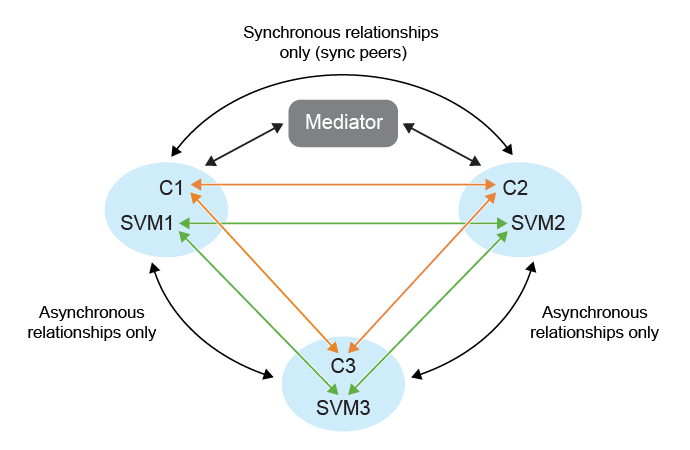

= ONTAP 도구의 팬아웃 보호
:allow-uri-read: 
:icons: font
:imagesdir: ../media/

[role="lead"]
팬아웃 보호 기능을 사용하여 두 대상 ONTAP 클러스터에 걸쳐 일관성 그룹을 보호할 수 있습니다. ONTAP tools는 SnapMirror 활성 동기화 보호 워크플로(생성, 편집 및 삭제)를 통해 동기 관계를 유지하고, VMware Live Site Recovery는 장애 조치 및 재보호 워크플로를 통해 비동기 관계를 유지합니다.

NOTE: SVM 사용자의 경우 팬아웃 보호 기능이 지원되지 않습니다. 팬아웃 보호 기능을 사용하려면 AutomatedFailOverDuplex 관계 외에도 비동기 관계가 필요하지만, ONTAP 툴은 SVM 사용자 자격 증명으로 추가된 스토리지 백엔드에 대한 비동기 보호 생성을 지원하지 않습니다.

팬아웃 보호를 설정하려면 세 개의 사이트 클러스터와 SVM을 피어링합니다.

다음 다이어그램은 팬아웃 보호 구성을 보여줍니다: image:../media/fan-out-protection.png["팬아웃 보호 구성"]

예:

만약에:

* 소스 정합성 보장 그룹이 클러스터 C1 및 SVM svm1에 있습니다
* 첫 번째 대상 정합성 보장 그룹은 클러스터 C2 및 SVM svm2 및 에 있습니다
* 두 번째 대상 정합성 보장 그룹이 클러스터 C3 및 SVM svm3에 있습니다

그 다음에,

* 소스 ONTAP 클러스터의 클러스터 피어링은 (C1, C2) 및 (C1, C3)입니다.
* 첫 번째 대상 ONTAP 클러스터의 클러스터 피어링은 (C2, C1) 및 (C2, C3) 등입니다
* 두 번째 대상 ONTAP 클러스터의 클러스터 피어링은 (C3, C1) 및 (C3, C2)입니다.
* 소스 SVM에서 SVM 피어링은 (svm1, svm2) 및 (svm1, svm3)입니다.
* 첫 번째 대상 SVM에서 SVM 피어링은 (svm2, svm1) 및 (svm2, svm3) 및 입니다
* 두 번째 대상 SVM에 대한 SVM 피어링은 (svm3, svm1) 및 (svm3, svm2)가 됩니다.

.단계
. 새로운 임시 데이터 저장소를 선택하십시오. 단계별 보호를 위한 임시 데이터 저장소 선택 기준은 다음과 같습니다.
+
** 보호하고 있는 호스트 클러스터에 플레이스홀더 데이터 저장소를 두지 마세요.
** 호스트 클러스터에 자리 표시자 데이터 저장소를 포함해야 하는 경우 SnapMirror 활성 동기화 보호를 설정하기 전에 VMware Live Site Recovery 어플라이언스에 추가하십시오. 이렇게 설정하면 자리 표시자 데이터 저장소를 보호 대상에서 제외할 수 있습니다.
+
자세한 내용은  https://techdocs.broadcom.com/us/en/vmware-cis/live-recovery/site-recovery-manager/8-8/site-recovery-manager-administration-8-8/about-placeholder-virtual-machines/configure-a-placeholder-datastore.html["자리 표시자 데이터 저장소를 선택합니다"]을(를) 참조하십시오.

. link:../protect/protect-multiple-ds.html["클러스터 내 데이터 저장소 보호"]에 따라 호스트 클러스터 보호에 데이터 저장소를 추가하십시오. 비동기 및 동기 정책 유형을 모두 추가하십시오.

